

<h1 align="center">Emanuel Mendonça</h1>

<strong>Analista de Sistemas Jr na <a href="https://ddmx.com.br">DDMX</a> • QA • São Paulo, Brasil</strong>

  
  
  

---

## Sobre mim

Profissional de Quality Assurance apaixonado por garantir que o software entregue valor real ao usuário. Planejo e executo testes funcionais, de regressão e end-to-end, acompanho bugs, valido provas de conceito e documento produtos. Atuo como ponte de comunicação entre Produto, Comercial e Suporte Técnico em ambiente ágil.

Antes de migrar para tecnologia, trabalhei com vendas e administração, o que trouxe comunicação clara, foco no cliente e visão de negócio para a minha forma de testar.

**Objetivo:** crescer como Analista de QA / Testes, evoluindo em automação (Selenium, Playwright e testes de API) e contribuindo para uma cultura de qualidade desde o início do desenvolvimento.

**Portfólio completo:** https://emanuel-mendonca.github.io

---

## Experiência e formação

| | |
|---|---|
| **[DDMX](https://ddmx.com.br) — Analista de Sistemas Jr** *(atual)* | Planejamento e execução de testes funcionais, de regressão e E2E; identificação e acompanhamento de bugs; validação de provas de conceito; documentação de produto; comunicação entre Produto, Comercial e Suporte Técnico em ambiente ágil. |
| **Vendas e Administração** *(trajetória anterior)* | Comunicação clara, foco no cliente e visão de negócio, que levo para a área de qualidade. |
| **Análise e Desenvolvimento de Sistemas — PUC Minas** *(em andamento)* | Graduação com projetos práticos em equipe. |

## Recomendação

> *"Profissional de grande senso de responsabilidade. Compromissado, absorve conhecimento com naturalidade e se adapta rapidamente a novos desafios. Perfil técnico/comercial de grande valia para a empresa. Um excelente perfil profissional para a equipe comercial."*
>
> **Roger Archeti R. Alves** — Founder Annexar • CSO Good Villages • Board Member & Startup Mentor
> Supervisionou Emanuel diretamente • 19 de junho de 2024 • recomendação recebida no [LinkedIn](https://www.linkedin.com/in/emanuel-mendoncaa/)

---

## Projetos

### 1. Garçom — pedidos de restaurante em tempo real
*PUC Minas • Eixo 4 • Aplicação Distribuída* • [repositório](https://github.com/ICEI-PUC-Minas-PMV-ADS/pmv-ads-2026-1-e4-infra-t1-garcom)

O cliente faz o pedido pelo app, ele aparece em tempo real na cozinha e o status é atualizado até o fechamento da conta. Arquitetura em 3 camadas.

- **Stack:** C# / ASP.NET Core 8, MongoDB Atlas, SignalR, JWT, React 19 + TypeScript + Vite, React Native + Expo
- **Testes e entrega:** xUnit, Playwright, Maestro, GitHub Actions, Vercel, Railway
- **Resultados:** 18/18 testes unitários aprovados, 5/5 fluxos E2E no mobile validados (Maestro) e suíte E2E web com Playwright rodando no CI.

  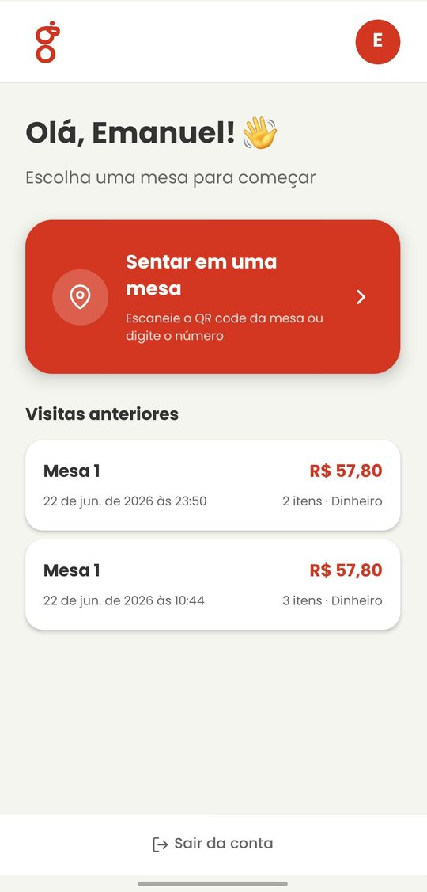
  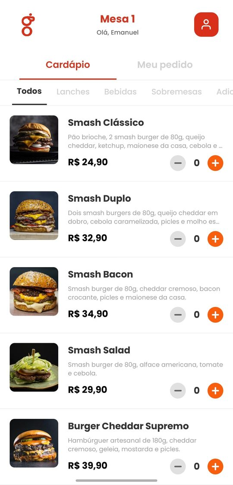
  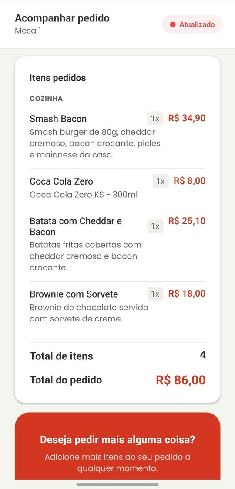
  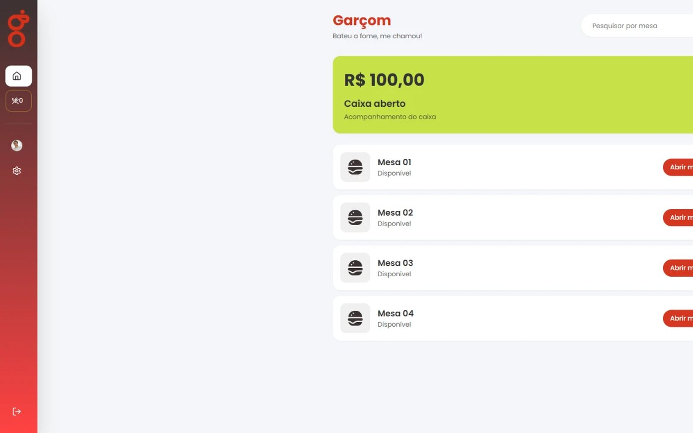

### 2. Devish Receitas — app de receitas
*Trabalho em equipe remota com Kanban* • [repositório](https://github.com/ICEI-PUC-Minas-PMV-ADS/pmv-ads-2025-2-e3-proj-mov-t4-devish-receitas)

Feed estilo rede social, área de exploração, criação de receitas próprias, favoritos, lista de compras automática a partir da receita e perfil editável.

- **Stack:** React Native + Expo

  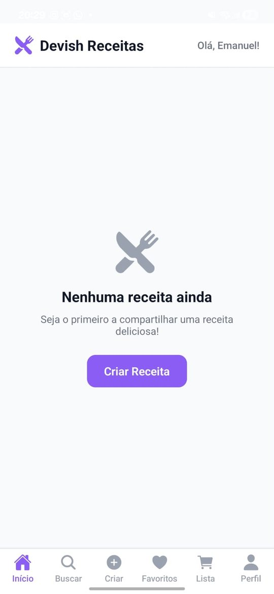
  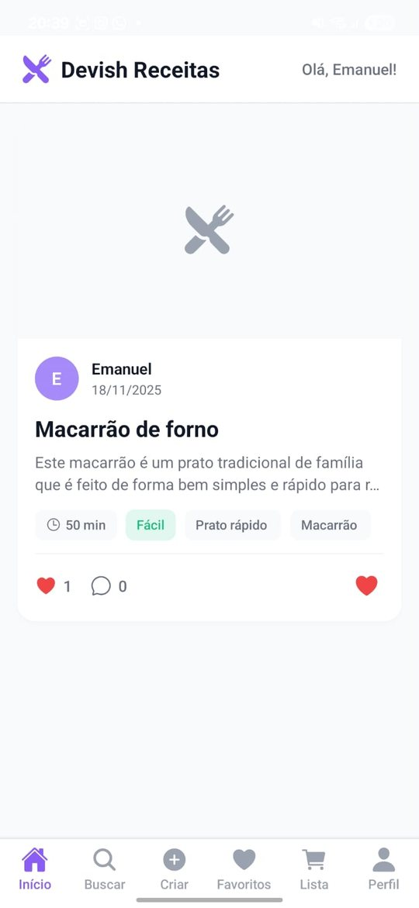
  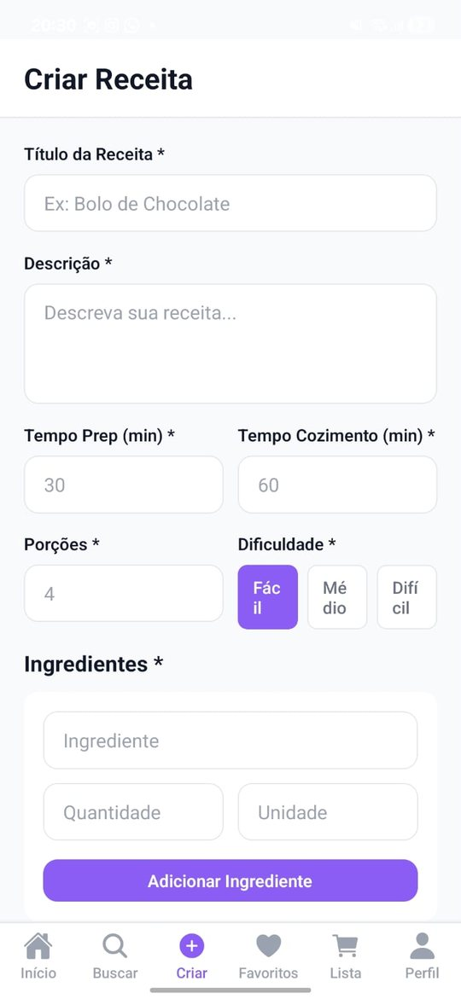

### 3. FinanShare — aplicação C# na Azure
*PUC Minas* • [repositório](https://github.com/ICEI-PUC-Minas-PMV-ADS/pmv-ads-2025-1-e2-proj-int-t2-finanshare)

Aplicação C# com back-end funcional implantado na Microsoft Azure e protótipo de UX/UI no Figma.

- **Stack:** C#, Microsoft Azure, Figma
- **Destaque:** projeto concluído em equipe reduzida (de 6 para 3 integrantes), com foco em resiliência e entrega sob prazo.

  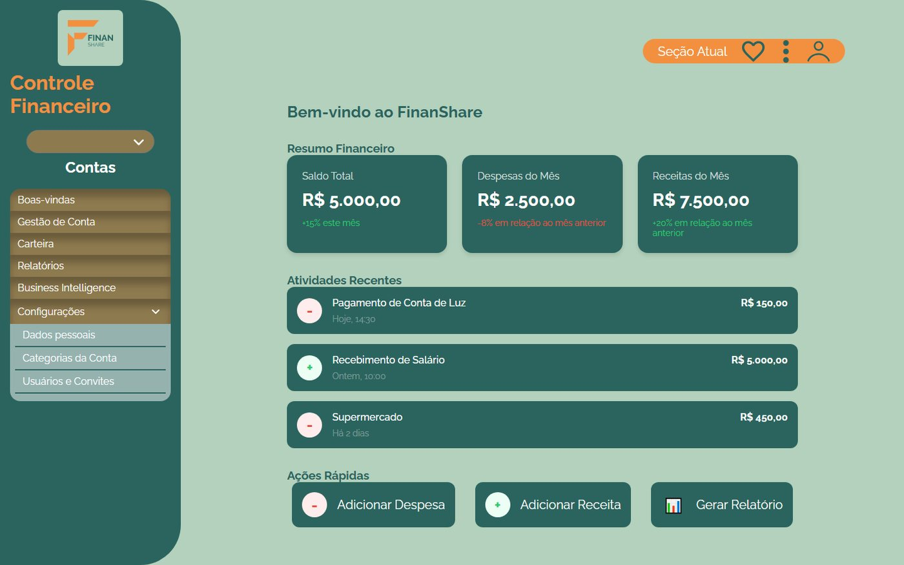
  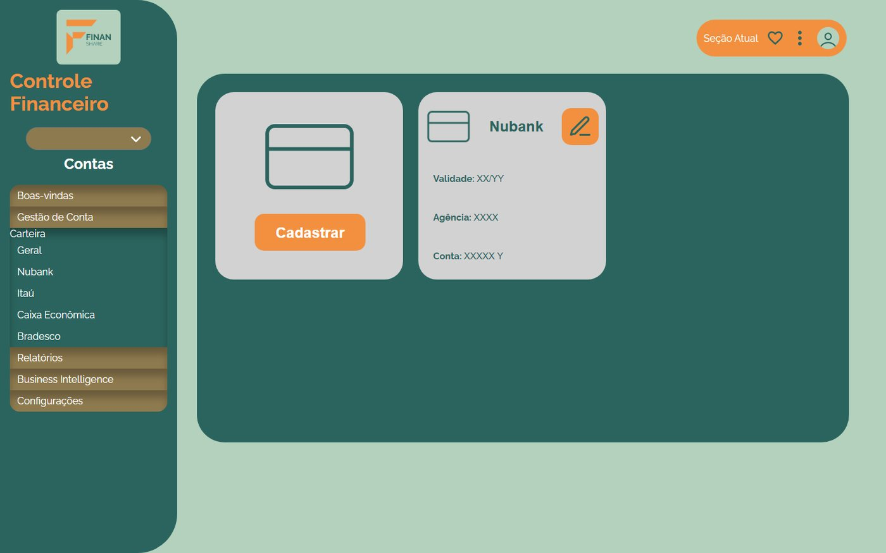

### 4. Controle da Compra (Vortex Cart)
*Aplicativo* • [repositório](https://github.com/Emanuel-Mendonca/vortexcart)

App para registrar compras de mercado e comparar gastos entre supermercados. Versão web concluída; versão mobile em React Native em desenvolvimento.

- **Stack:** React Native

  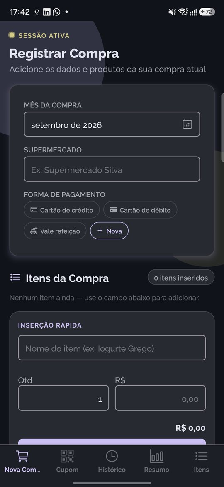
  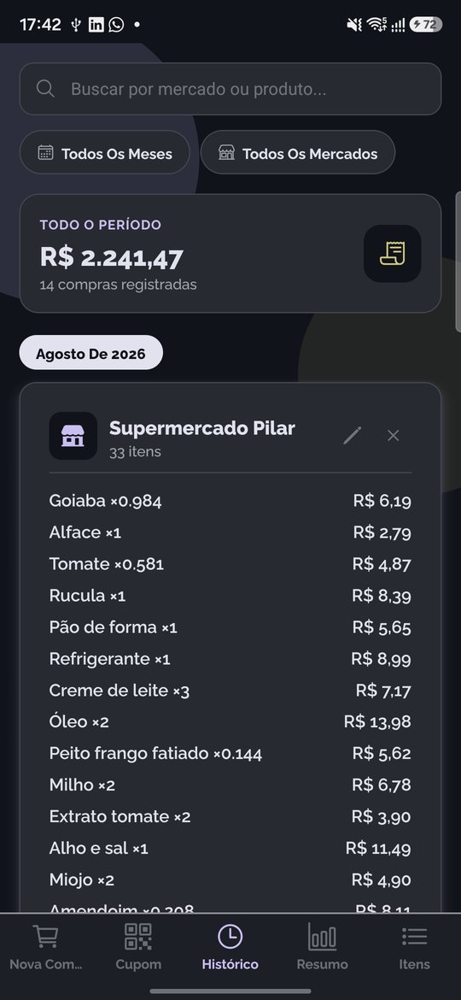
  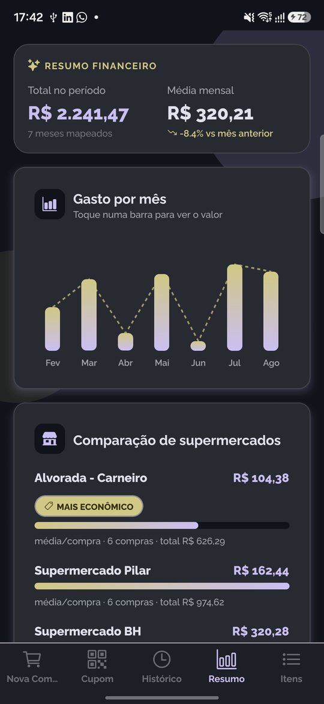

### 5. Orbis — PDV e gestão de estoque
*PUC Minas • parceria com a [Gran Burguer](https://www.granburguer.com.br/)* • [repositório](https://github.com/ICEI-PUC-Minas-PMV-ADS/pmv-ads-2026-2-e5-proj-empext-t6-pmv-ads-2026-2-e5-proj-empe-group-3)

PDV integrado ao controle de estoque, à API de pedidos do UaiRango e a dashboards de BI, com análise de cupons e gestão de insumos.

- **Stack:** PHP 8.4 + Laravel 13, MySQL, JWT, React 19 + TypeScript + Vite, Tailwind CSS 4, TanStack Query, UaiRango Connect (OAuth 2.0), Docker
- **Testes:** PHPUnit, Vitest, Playwright
- **Resultados:** 304 testes de backend e 255 de frontend, todos aprovados (18/10/2026).

  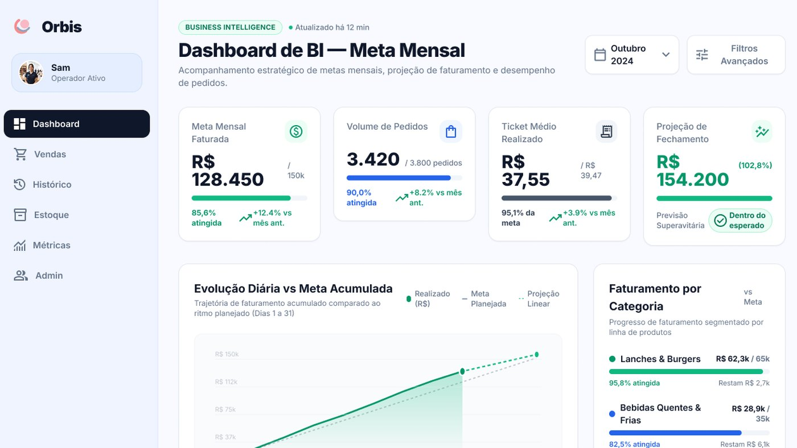
  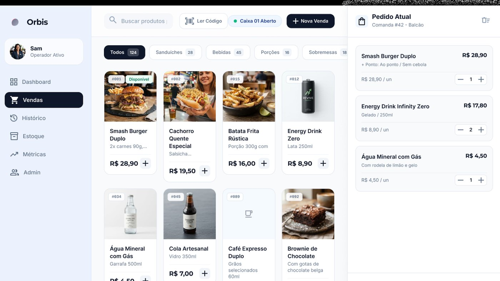
  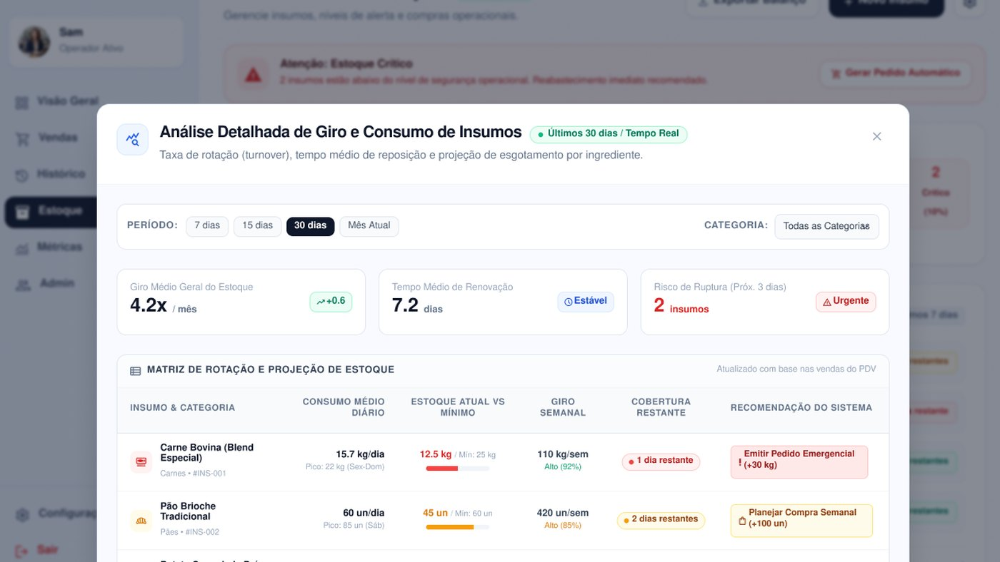

> Os repositórios da PUC Minas ficam em uma organização acadêmica e podem não estar abertos ao público.

---

## Habilidades

| Área | Ferramentas e tecnologias |
|---|---|
| **Testes** | Testes funcionais, de regressão e E2E, casos de teste, gestão de bugs |
| **Automação e testes de código** | Cypress, Robot Framework, Playwright, Maestro (mobile), BDD, xUnit, PHPUnit, Vitest |
| **Linguagens** | C#, PHP, TypeScript, JavaScript, HTML, CSS / Sass |
| **Frameworks e plataformas** | ASP.NET Core 8, Laravel 13, React 19, React Native, Expo, Vite, Tailwind CSS 4 |
| **Tempo real e integrações** | SignalR, JWT, Swagger / OpenAPI, UaiRango Connect (OAuth 2.0), TanStack Query |
| **Dados, nuvem e deploy** | MongoDB Atlas, MySQL, Docker, Azure App Service, Vercel, Railway, Hostinger |
| **Ferramentas e fluxo** | Git / GitHub, GitHub Actions (CI/CD), Figma, Trello |
| **Metodologias ágeis** | Scrum, Kanban |

## Cursos e certificações

**Tecnologia e QA**
- [Robot Framework: Automatizando Testes no Padrão BDD](https://cursos.alura.com.br/certificate/25364b02-79b8-4db3-9c59-e631fe1f36b8?lang) — Alura • mar. 2025
- [Cypress: Automatizando Testes E2E](https://cursos.alura.com.br/certificate/055c41d4-4671-4f20-b4bf-d41ed8bb3d04?lang) — Alura • mar. 2025
- [Quality Assurance: Plano de Testes e Gestão de Bugs](https://cursos.alura.com.br/certificate/e591088b-8f95-4866-bfc3-ceec791b202c?lang) — Alura • fev. 2025
- [Git e GitHub: Compartilhando e Colaborando em Projetos](https://cursos.alura.com.br/certificate/d667aeba-a929-48cf-847d-0d2ff807b50d?lang) — Alura • mar. 2025
- [Lógica de Programação: Mergulhe em Programação com JavaScript](https://cursos.alura.com.br/certificate/2dbe403a-5606-4046-91fb-ca3f3ee1728d?lang) — Alura • mar. 2025
- Engenharia de Prompt para Engenheiros de Software — MBA USP/Esalq • mar. 2026

**Agilidade**
- [Kanban: Análises para Implementação](https://cursos.alura.com.br/certificate/7e59b25e-4cc2-4c93-a1f8-62439953bb7b?lang) — Alura • dez. 2024
- Scrum: Agilidade em Seu Projeto — Alura • dez. 2024
- [Equipes Ágeis: Organizando os Papéis em Uma Equipe](https://cursos.alura.com.br/certificate/077a1bc5-df0a-4075-9a7f-98ce26d12328?lang) — Alura • nov. 2024
- [Escalando Equipes Ágeis: Como Levar a Agilidade Adiante na Organização](https://cursos.alura.com.br/certificate/2d1c1d4e-243a-4e2b-9621-52e2ebe30c01?lang) — Alura • nov. 2024

**PUC Minas** (verificação em [web.sistemas.pucminas.br/GAD/DOC/Verificador](https://web.sistemas.pucminas.br/GAD/DOC/Verificador))
- Qualificação Profissional de Nível Tecnológico em Desenvolvedor de Software • ago. 2025 • código `AA785FCA9CFC37FB982FBFDF3143587C`
- Qualificação Profissional de Nível Tecnológico em Analista de Software • jul. 2026 • código `7705137DBC725C45C880DFADAF7ACF75`

**Vendas e gestão**
- Certificado para Software de Sales HubSpot — HubSpot • jan. 2025
- Planejamento Estratégico — Grupo Voitto • abr. 2024
- Gestão de Pessoas com Ênfase em Liderança Organizacional — Escola Conquer • set. 2023
- Gestão de Pré-Venda e Capacitação em Pré-Venda — Exact Sales • nov. 2022
- Resolução de Problema — Ganbatte Consultoria & Treinamento • dez. 2021
- Estratégia para Aumentar Receitas — Grupo Voitto • jul. 2021

## Fora do código

Atrás de todo teste bem feito existe uma pessoa. Fora da tela, sou mais de montanha, de balcão de bar, de mesa cheia e de conversa boa.

**Onde eu recarrego.** É na natureza que eu recarrego as energias. Gosto de estar ao ar livre, praticar esportes e viver experiências novas. Já participei de alguns campeonatos, mas, mais do que competir, gosto das histórias que ficam pelo caminho, principalmente quando as coisas não saem como planejado. Já improvisei uma refeição para todo mundo com o que tínhamos à mão e já demos um jeito quando o cabo do acelerador estourou no meio da viagem. Acho que levo um pouco disso para o trabalho também: quando algo dá errado, busco uma solução, me adapto e sigo em frente.

**Antes da tecnologia.** Foram mais de 3 anos trabalhando como bartender no [Espaço Goma](https://www.instagram.com/espacogoma/), ao lado de uma equipe que fez parte da minha história. Mais do que servir drinks, foi uma experiência que me ensinou muito sobre lidar com pessoas, trabalhar em equipe e saber se virar em diferentes situações.

**Perto de quem importa.** Família e amigos são o meu chão. É com eles que eu me sinto em casa. Gosto de estar por perto, de trocar experiências e de lembrar que nenhuma conquista tem graça sem gente para dividir.

  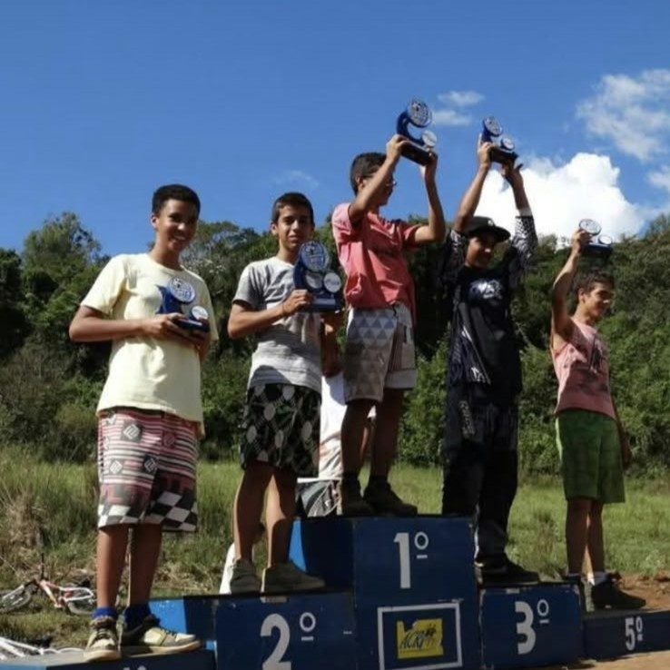
  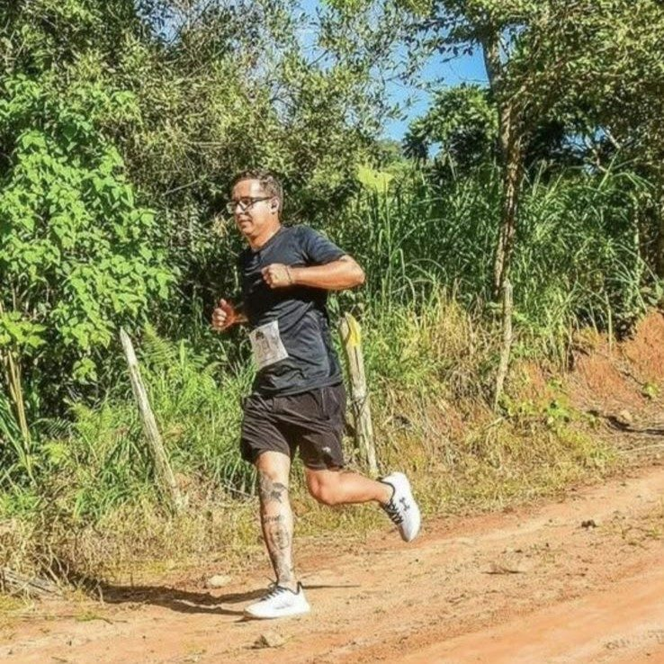
  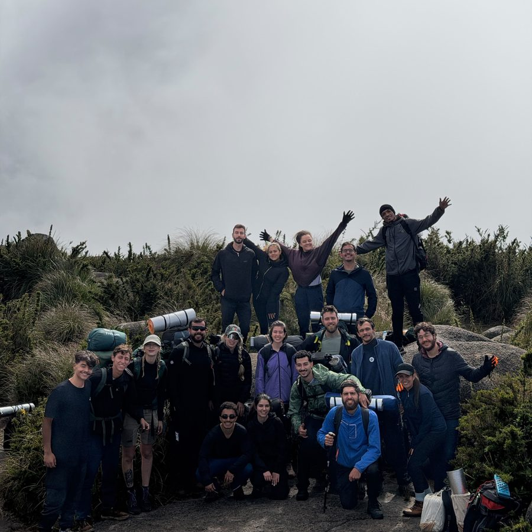
  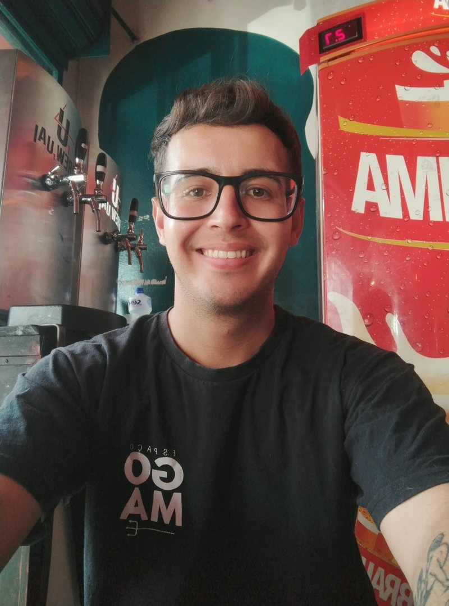

---

---

## Vamos conversar?

Gosto de produtos bem pensados, de bugs encontrados antes de virarem problema e de uma boa conversa sobre qualidade. Se isso soa familiar, chega mais: um café, um e-mail ou uma mensagem já é um ótimo começo.

[emanueldh597@gmail.com](mailto:emanueldh597@gmail.com) • [LinkedIn](https://www.linkedin.com/in/emanuel-mendoncaa/) • [Portfólio](https://emanuel-mendonca.github.io)
